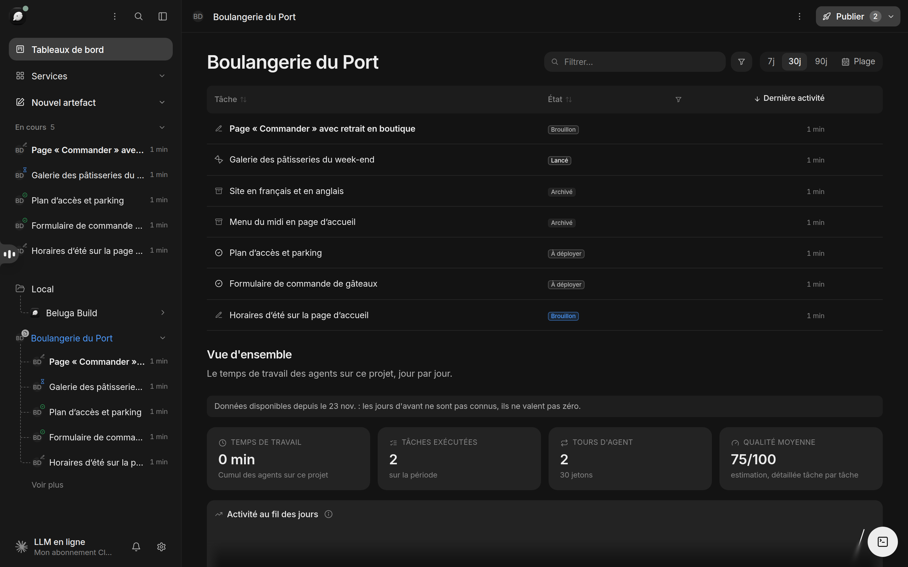
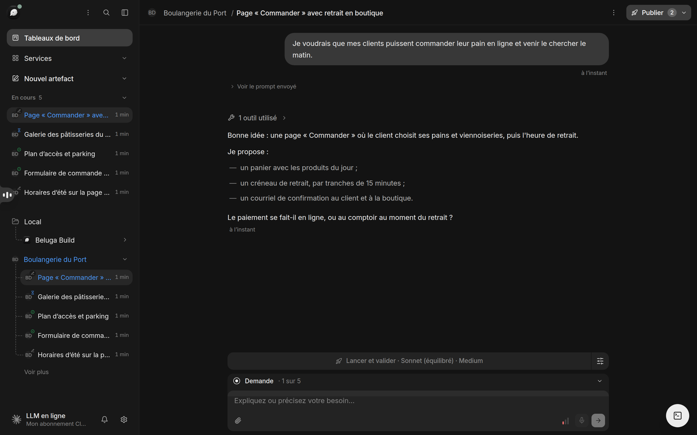
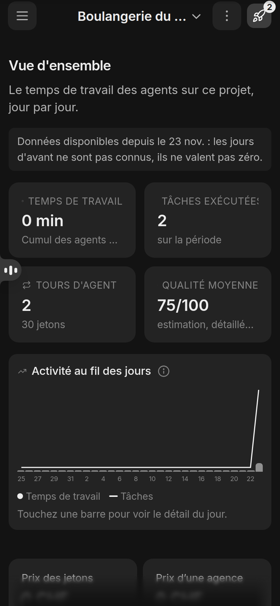
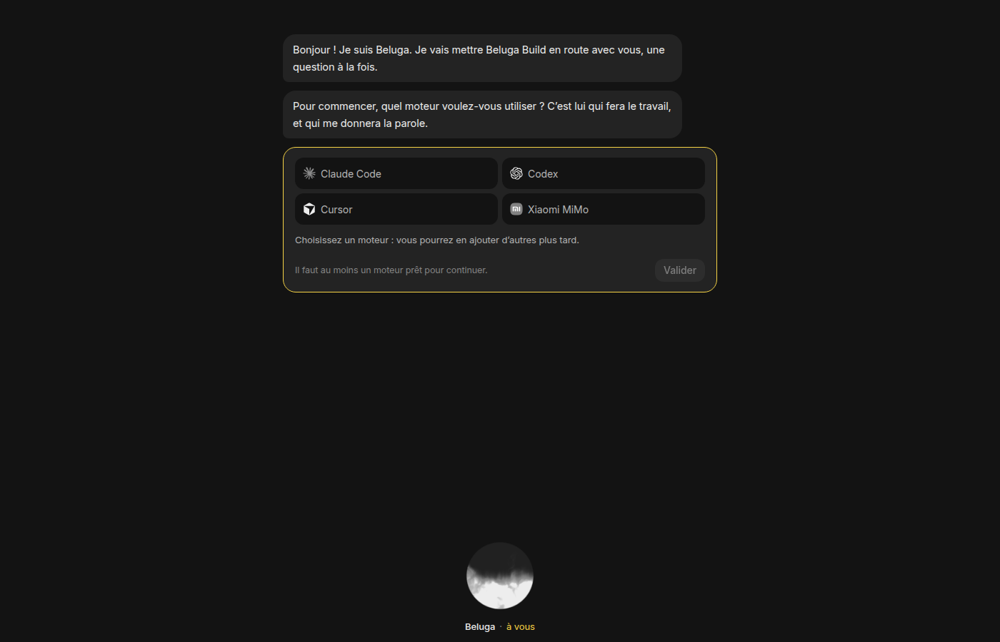

<p align="center">
  
</p>

<h1 align="center">Beluga Build</h1>

<p align="center">
  <strong>Pilotez vos projets avec des agents IA, sur votre propre serveur.</strong><br />
  Libre et open source · <a href="LICENSE">AGPL-3.0</a> · en cinq langues
</p>

<p align="center">
  <a href="#installer-beluga-en-une-commande">Installer</a> ·
  <a href="#trois-façons-dutiliser-beluga">Gratuit, Cloud ou Pro</a> ·
  <a href="CONTRIBUTING.md">Contribuer</a> ·
  <a href="https://github.com/haikostudio/beluga/discussions">Discussions</a>
</p>

> **In English.** Beluga Build is a free, open-source (AGPL-3.0) project cockpit for AI coding agents.
> A kanban board where every card opens on its own scoping conversation, then hands the work to a
> full agent (Claude Code, Codex, Cursor — your own subscriptions) that runs on your server, on its
> own branch, and never ships without your click. Install it on any Debian/Ubuntu server with the
> one-liner below, or let us run it for you on [Beluga Cloud](https://belugabuild.com).



## Ce que fait Beluga Build

Un **tableau** où chaque carte suit le travail réel d'un agent, et un **démon** qui fait tourner le
tout sur votre serveur.

- **Une carte se cadre avant de partir.** Le « + » ouvre une carte et sa conversation, tenue par un
  agent léger qui discute le besoin et écrit au fur et à mesure le titre, la description et le plan,
  sans toucher au code. Rien ne part au moteur d'exécution avant votre clic sur « Lancer ».
- **Des agents complets, chacun sur sa branche.** Une carte lancée a sa propre copie de travail ;
  l'agent analyse, modifie, teste, enregistre et sauvegarde — mais ne publie jamais de lui-même.
- **Une mémoire de projet.** Décisions, conventions, pièges déjà rencontrés : au lancement d'une
  carte, seuls les passages utiles partent à l'agent. Elle démarre **vide** et grandit avec vous.
- **Des compétences.** Des modes d'emploi que les agents ouvrent quand une tâche entre dans leur
  champ ; Beluga en écrit de nouvelles à partir des tâches réussies, et en importe des bibliothèques
  publiques.
- **Une publication maîtrisée.** Enregistrer, sauvegarder, déployer puis mettre en production
  restent des étapes séparées, suivies sur une ligne de temps, rejouées si l'une tombe.
- **Un coffre-fort** pour les accès (clés, mots de passe, SSH, bases), commun à tous les projets.
- **Des services autour** : espace client et messagerie, surveillance des sites, sauvegardes,
  statistiques de visites, studio vidéo, réseaux sociaux.
- **Apportez vos propres abonnements d'IA.** Beluga pilote les outils en ligne de commande que vous
  connectez vous-même (Claude Code, Codex, Cursor), avec un suivi de quota par compte. Il ne revend
  aucun appel.
- **Une interface installable**, pensée téléphone et ordinateur, en français, anglais, espagnol,
  allemand et chinois, avec six ambiances en clair et en sombre.

<p align="center">
  
  
</p>

## Trois façons d'utiliser Beluga

| | **Gratuit** | **Cloud** | **Pro** |
|---|---|---|---|
| Prix | 0 € | **dès 22 € / mois** | sur demande |
| Le logiciel | complet, ce dépôt | le même | le même |
| Le serveur | le vôtre, installé par vous | un serveur à vous, installé et tenu à jour par l'équipe Beluga — vous le choisissez à la commande | installé et tenu pour vous, selon votre besoin |
| Mises à jour | d'un clic, depuis ce dépôt | automatiques | automatiques |
| En plus | — | adresse sécurisée, compétences protégées réservées aux serveurs Cloud | plusieurs personnes, votre domaine et votre marque, assistance prioritaire, facture, autre licence que l'AGPL |
| | [Installer](#installer-beluga-en-une-commande) | [belugabuild.com](https://belugabuild.com) | [salut@haiko.studio](mailto:salut@haiko.studio) |

La version gratuite **n'est pas bridée** : le Cloud et le Pro vendent un service, pas des
fonctions. Passer de l'un à l'autre emporte tout votre espace (projets, fichiers, mémoire,
coffre-fort, historique).

## Installer Beluga en une commande

Il vous faut un serveur **Debian ou Ubuntu** que vous administrez (un VPS de 4 Go de mémoire suffit
pour commencer). La commande installe tout le reste :

```bash
curl -fsSL https://raw.githubusercontent.com/haikostudio/beluga/main/scripts/installer.sh | sudo bash
```

Elle pose une seule question — **votre nom de domaine**, si vous en avez un — puis :

1. installe ce dont Beluga dépend (Node 22, git, le serveur web Caddy, l'outil GitHub, le terminal
   partagé) ;
2. crée un compte système dédié, `beluga`, et télécharge le code dans `/opt/beluga` ;
3. construit l'application et installe sa **mémoire « par le sens »** (environ 800 Mo sur le disque) ;
4. lui donne une **adresse sécurisée** : votre domaine s'il mène déjà au serveur, sinon une adresse
   provisoire tirée de son adresse IP ;
5. pose de quoi envoyer des courriels depuis le serveur lui-même (écoute locale seulement) ;
6. démarre l'application comme un service, relancé seul au redémarrage ;
7. affiche un **lien d'installation**.

Ce lien mène droit à la création de **votre compte** ; il ne sert qu'une fois. Un **assistant de
démarrage** prend ensuite le relais, en conversation : il installe et connecte un moteur d'un
bouton, puis propose (sans l'imposer) le domaine, GitHub et un premier projet, les courriels,
l'espace client, les compétences et la voix. Tout ce qui est passé se retrouve dans **Réglages →
Installation**. Une installation neuve part **vide** : aucun projet, aucune mémoire, un coffre-fort
vide.



Pour voir ce que le script ferait sans rien changer :

```bash
curl -fsSL https://raw.githubusercontent.com/haikostudio/beluga/main/scripts/installer.sh -o installer.sh
sudo bash installer.sh --a-blanc
```

Autres options : `--domaine beluga.exemple.com`, `--sans-question`, `--dossier`, `--compte`,
`--branche`.

### Ce que l'installation change sur votre serveur

- des paquets système (Node, Caddy, l'outil GitHub, de quoi compiler, tmux, dnsutils, et postfix
  réglé pour n'écouter que la machine elle-même) ;
- le compte `beluga`, avec les **droits d'administration sans mot de passe**
  (`/etc/sudoers.d/90-beluga-beluga`) : Beluga administre le serveur pour vous et ses agents
  travaillent sous ce compte — installez-le sur une machine que vous lui réservez ;
- `/opt/beluga` (le code et, sous `data/`, vos données) et `/home/beluga/projets` (vos projets) ;
- `/etc/caddy/Caddyfile` et `/etc/caddy/beluga.d/`, `/etc/beluga.env`, et les unités
  `beluga.service`, `beluga-watchdog.*`, `beluga-releve-projets.*`.

### Les mises à jour

Quand ce dépôt avance, une bande « Une nouvelle mise à jour de Beluga est disponible » le signale ;
rien ne s'applique sans vous (**Réglages → Mise à jour**). Si vous avez fait de votre installation
**votre propre copie** (sur votre GitHub), un agent rapproche les nouveautés de vos modifications et
s'arrête pour vous demander quoi faire au moindre conflit.

### Installation à la main

Sur une machine déjà équipée (Node ≥ 22, git, un reverse-proxy), sous un compte ordinaire — jamais
`root`, les moteurs le refusent :

```bash
git clone https://github.com/haikostudio/beluga.git
cd beluga
NODE_ENV=development npm install --include=dev
npm run build                              # shared, puis server, puis web
sudo scripts/installer-services.sh         # pose le service sous le compte propriétaire du dossier
node scripts/code-installation.mjs --lien  # le lien d'installation, prêt à cliquer
```

L'application écoute en local (`127.0.0.1:7070`) : placez un reverse-proxy devant elle.

### Commandes de secours

Sous le compte du service (`sudo -u beluga …`), depuis le dossier de l'installation :

```bash
node scripts/code-installation.mjs --lien  # un nouveau lien d'installation, tant qu'aucun compte n'existe
node scripts/set-credentials.mjs           # un nouveau mot de passe pour le compte principal
sudo systemctl status beluga.service       # le service tourne-t-il ?
tail -50 data/logs/service.log             # ce qu'il a écrit en dernier
```

## Vos données restent chez vous

Tout ce qui vous appartient (base, coffre-fort, mémoire, projets, historiques) vit sous `data/`, un
dossier **jamais suivi par git**. Les identifiants des moteurs (`~/.claude`, `~/.codex`…) restent sur
le disque du serveur. Réglages → Système exporte et réimporte l'intégralité de vos données en une
archive lisible, sans jamais rien écraser par défaut.

Ce dépôt ne contient que le programme : ni identifiant, ni clé, ni adresse d'une installation, ni
mémoire de projet. Chaque version publiée passe par un tri qui **refuse l'envoi** au moindre fichier
personnel (base, mémoire, coffre, nom de projet ou de client).

## Ce qui fait tourner le tout

| Dossier | Rôle |
| --- | --- |
| `server/` | Le démon : base, protocole, ordonnanceur, agents, outils, publication |
| `web/` | L'interface : tableau, conversations, réglages, application installable |
| `shared/` | Les règles pures, sans base ni disque — donc testables seules |
| `scripts/` | Installation, service système, commandes de secours |
| `competences/` | Les compétences publiques livrées avec le code |

```bash
NODE_ENV=development npm install --include=dev
npm run build      # shared, puis server, puis web
npm test           # les tests du démon
npm run dev --workspace web -- --port 7099   # l'interface de développement
```

## Contribuer

Les idées se proposent et se votent dans les
[Discussions](https://github.com/haikostudio/beluga/discussions), les défauts se signalent dans les
[Issues](https://github.com/haikostudio/beluga/issues), le code arrive par pull request. Un robot
vous demande de signer une fois l'[accord des contributeurs](CLA.md). Ce dépôt est le miroir du
dépôt de travail : une proposition retenue y est **rapatriée à votre nom**, puis repart avec la
version suivante — tout est expliqué dans [CONTRIBUTING.md](CONTRIBUTING.md). Une faille de
sécurité se signale en privé : [SECURITY.md](SECURITY.md).

## Licence et marque

Beluga Build est un logiciel libre sous [GNU AGPL-3.0](LICENSE) — détails, et ce qui reste à vous,
dans [LICENSING.md](LICENSING.md). Vous pouvez l'utiliser, l'étudier, le modifier et le partager,
y compris pour un usage commercial ; une copie modifiée offerte en ligne doit publier son code.
Le nom, le logo et le béluga sont protégés : une copie distribuée prend son propre nom
([TRADEMARKS.md](TRADEMARKS.md)).

Copyright © 2026 Haiko Studio.
